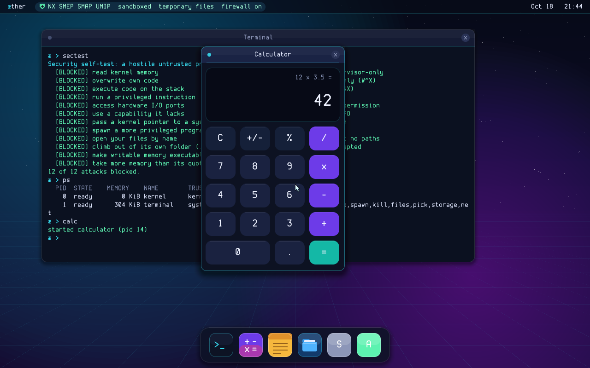
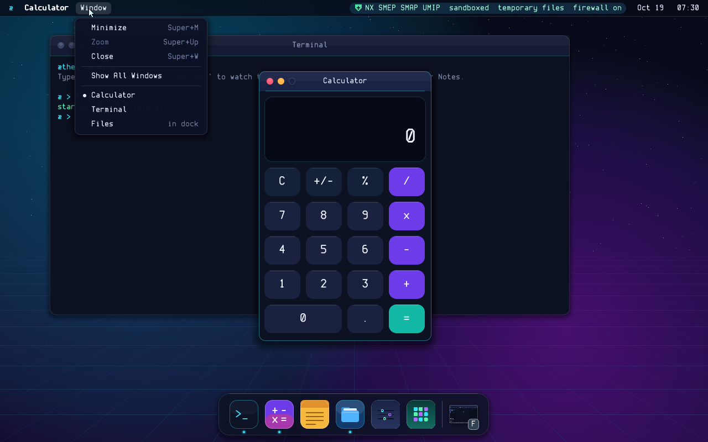
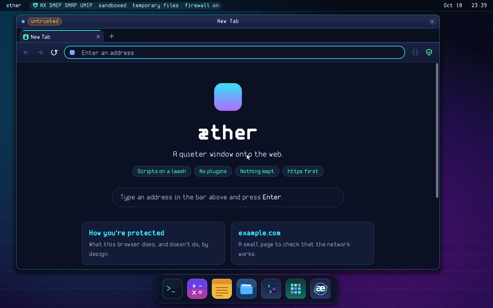
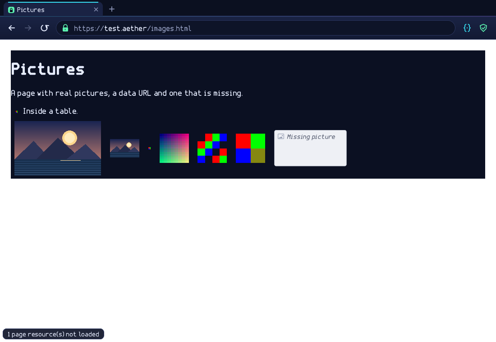
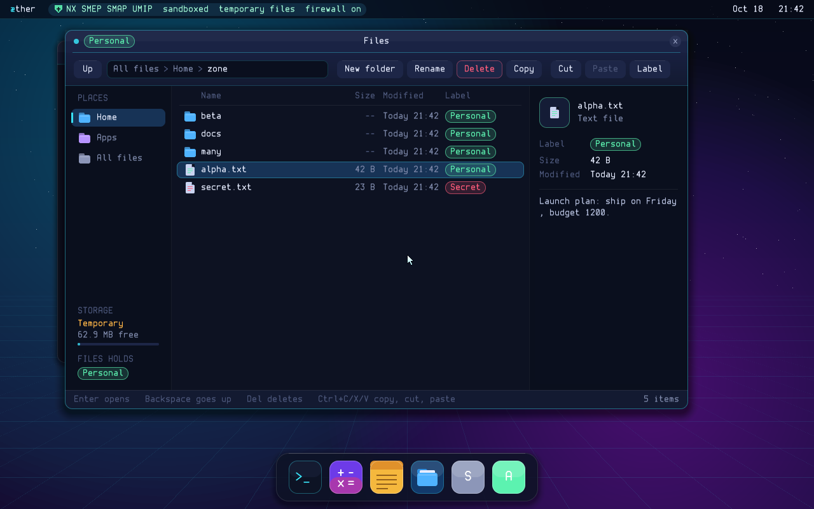
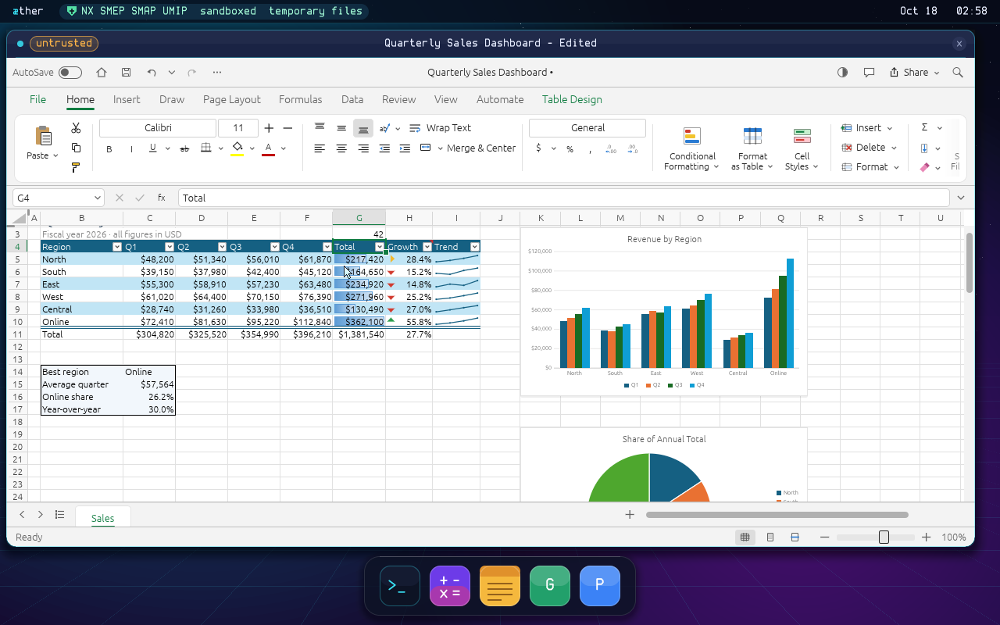
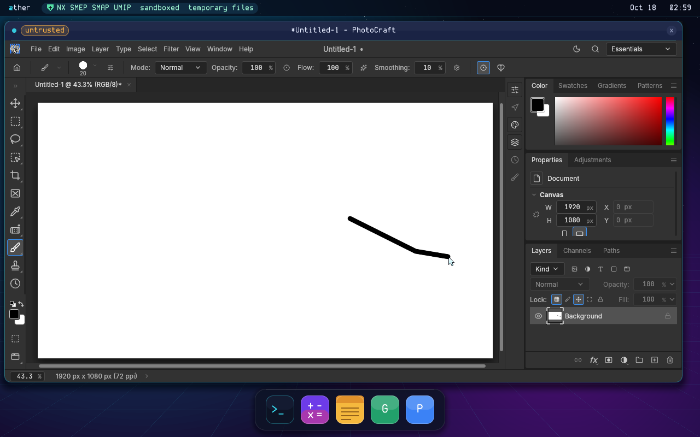
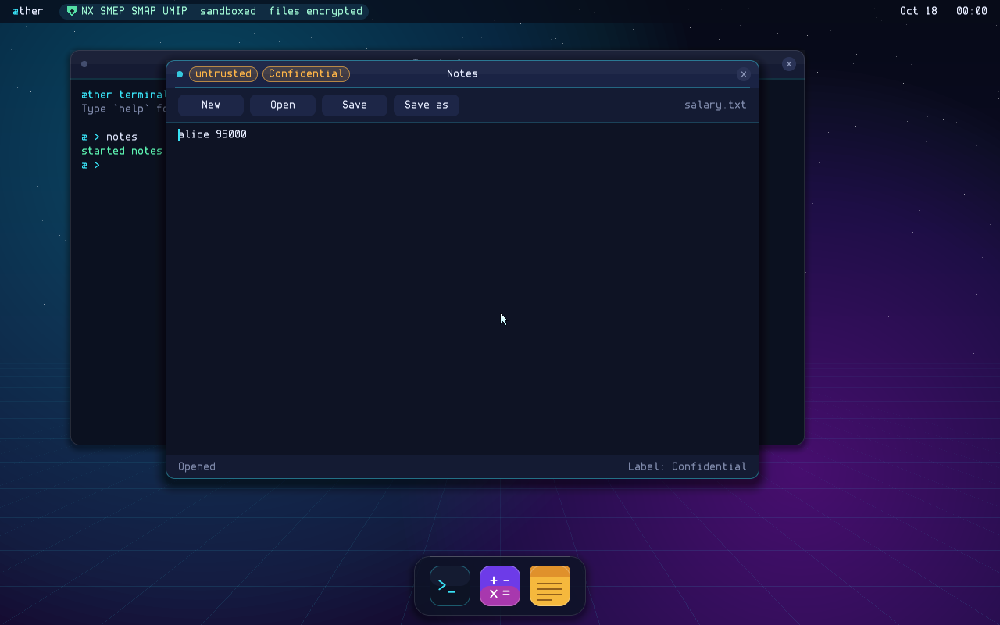
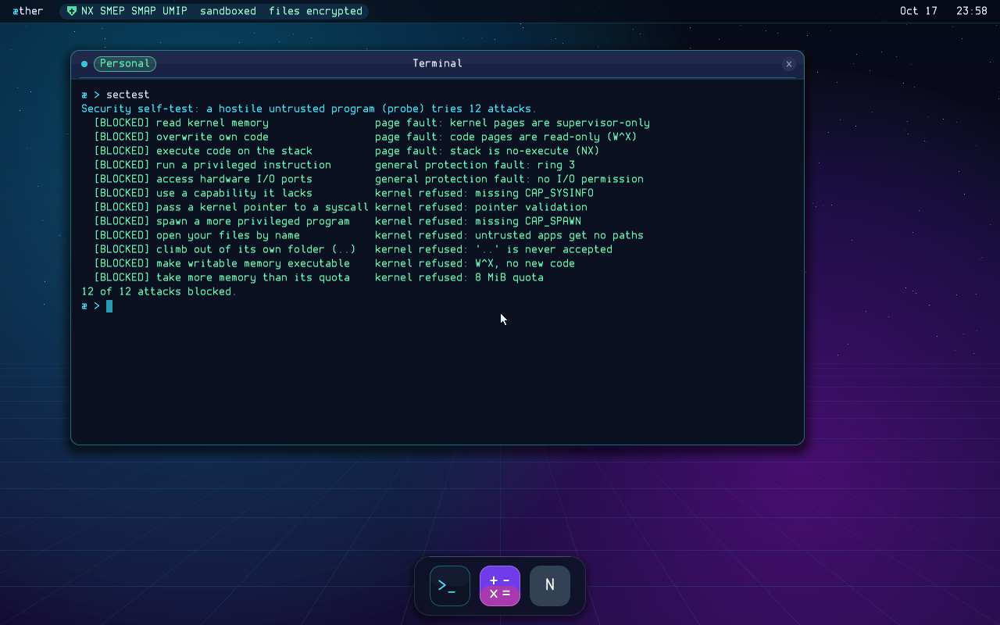

# æther

A from-scratch x86_64 operating system with security as its foundation,
written entirely by Claude (white room: no third-party code, no borrowed
fonts, no GRUB/Limine/gnu-efi). It boots on UEFI machines: VMware
Workstation and real laptops today.



## What's new in 1.3 (daily-driver workstream)

- **Change the disk passphrase** from Settings > Security. The kernel verifies
  the old one, re-wraps the volume key and never stores either passphrase.
- **Shut Down** in the æ menu, through ACPI S5 (with a QEMU/Bochs fallback).
  `make test-power` checks the kernel reaches the power-off path.
- The Security page now combines auto-lock, Lock Now, passphrase change and
  the storage/protection status.

## What's new in 1.0

- **A desktop you can leave alone.** **Super+L** or the æ menu locks the
  screen; Settings > Security sets an idle auto-lock (10 minutes by
  default). Unlocking checks the passphrase against the key-wrap record
  without reinitializing the file system, the desktop is not drawn while
  locked, and no app receives input. **Ctrl+Alt+Esc** closes the app behind a
  stuck system dialog (or the focused app), so a picker loop can't trap you.

- **The 1.0 security review.** System-dialog answers are now owned by the
  thread that asked, so a sibling thread can no longer turn a "Block" into an
  "Allow once" (or approve another file's label change); background apps
  can't steal keyboard focus by creating a window; window slots are recycled;
  and a failed `SYS_WIN_CREATE` no longer leaks the window and its buffer.
  File sizes and partial reads now taint DLP the same way full reads do.
  AFS refuses hostile superblock arithmetic, validates inode block pointers,
  and no longer resurrects truncated data; the GPT writer puts the backup
  table where the parser looks for it.

- **Install and update integrity.** The signed system image now pins the
  SHA-256 of the boot image, so a fresh install can't pair a signed kernel
  with a bootloader from another download. App updates keep the permissions
  you already approved, and installed apps are capped at 512 MiB.

- **Files that survive mistakes.** The save picker no longer truncates a file
  before the app writes it; Notes writes first and truncates to the new
  length, and reports a failed save instead of losing the old contents.

- **Network consent is harder to bypass.** UDP replies are checksum-checked,
  DNS answers must belong to the name (or its CNAME chain), connection
  handles carry a generation, LAN/special-use IP literals always ask instead
  of using the browser's silent web policy, and untrusted apps no longer see
  your IP addresses, DNS server or MAC.

- **Smaller everyday fixes.** Settings has a Security page and a scrollable
  firewall list that names the built-in browser policy; the installer asks
  for the disk passphrase twice and explains what is verified; Calculator
  reads scientific notation back correctly; the menu bar has Lock Screen and
  Restart.

## What's new in 0.9 (in progress)

- **USB works on real laptops.** A polled xHCI driver (`kernel/usb.c`) brings
  up root-port devices, and class drivers cover boot-protocol HID keyboards
  and mice (`usb_hid.c`) and CDC-ECM USB Ethernet (`usb_net.c`). A USB mouse
  and a USB Ethernet dongle now work on the Yoga; QEMU's `qemu-xhci`,
  `usb-kbd`, `usb-mouse` and `usb-net` cover all three paths in `make
  test-usb`.

- **The Yoga touchpad.** `kernel/i2c_hid.c` drives the Alder Lake LPSS I2C1
  controller, reads the HID-over-I2C descriptor and report descriptor, and
  turns relative mouse or absolute Precision-Touchpad reports into pointer
  events. It polls the input register (the kernel has no ACPI/GPIO
  interrupt interpreter yet) and has tap-to-click for clickpads without
  separate button fields. The touchpad still needs validation on the
  physical machine; see [docs/DRIVERS.md](docs/DRIVERS.md).

- **Boot-time driver evidence** appears on the serial console and in the
  Terminal's `log`: xHCI ports, USB class drivers, LPSS I2C probes, and the
  selected touchpad report type. `make test-usb` checks enumeration, HID
  input and DHCP over USB Ethernet.

## Desktop work after 0.8 (in progress)

- **Window controls you already know, drawn from scratch.** Three lights on
  each title bar close, minimize to the dock, and zoom to fill the screen
  between the menu bar and the dock. Double-click a title bar to zoom;
  drag an edge or corner to resize.
- **A menu bar** with an æ menu (apps, minimize or show all windows), the
  focused app's menu, and a Window menu listing every window. Security
  status and the clock moved to its right side.
- **A window switcher**: hold Super or Alt and press Tab. Super+M minimizes,
  Super+Up zooms, Super+W / Super+Q close.
- **A smarter dock**: running apps have a light, clicking a running app
  brings it forward instead of starting another copy, and minimized windows
  sit at the right end as small pictures.
- **Resizable apps**: a new opt-in protocol (`SYS_WIN_FLAGS`, `EV_RESIZE`,
  `SYS_WIN_RESIZE`). Notes, Files, the browser and egui apps resize;
  fixed layouts keep their size. See [docs/WINDOWS.md](docs/WINDOWS.md).



## What's new in 0.8 (in progress)

- **A netboot installer.** `build/aether-netboot.iso` is a small, stable
  bootstrap: it runs from RAM, leaves the target disk untouched until you
  choose Install, and downloads the boot and system images from the latest
  GitHub release. The installer writes a GPT with a fixed ESP, a CRC-checked
  A/B boot-control record, two 256 MiB system slots and an encrypted data
  partition. See [docs/INSTALL.md](docs/INSTALL.md).

- **Self-updating installed systems.** App Store's OS tab downloads the
  latest system image, verifies GitHub's SHA-256 digest, the image's own
  canonical hash and the offline RSA-2048 release signature, and writes it to
  the inactive A/B slot. The running slot and
  the encrypted files are never touched. The loader tries a new slot twice
  and falls back automatically if it cannot reach the kernel's storage path.
  The loader is stable; only the system image changes per release, so the
  netboot ISO is rebuilt only on a deliberate `netboot-v*` tag.

- **A Rust NVMe driver.** The first ring-0 driver written in Rust: a
  `no_std` static library with no allocator, checked queue depths, owned DMA
  pages, bounded PRP lists, PIT-based timeouts and overflow checks. It
  registers as `nvme0` and has been tested under QEMU against reads, writes,
  flush, GPT parsing and formatting the AFS data partition. See
  [docs/DRIVERS.md](docs/DRIVERS.md).

- **Physical-hardware work started, with explicit gaps.** The Yoga 9 14IAP7
  target has NVMe and an i8042 keyboard, but the 0.8 slice still lacks USB
  xHCI/Ethernet, I²C-HID touchpad and AX211 Wi-Fi. The netboot and update
  logic work; running them on that laptop needs the next driver slice. The
  inventory and status are in [docs/DRIVERS.md](docs/DRIVERS.md).

## What's new in 0.7

- **A Chrome-like browser, still clean-room.** The window now has a tab
  strip: **Ctrl+T** opens a tab, **Ctrl+W** closes it, **Ctrl+Tab** switches,
  **Ctrl+1**…**Ctrl+9** jump to one. Every tab keeps its own history, scroll
  position, script choice and http consent. The toolbar and the new-tab page
  follow the same design. No Chromium code, no external crates: the shell is
  Rust on top of æther's own HTML/CSS/script engine.

- **Pictures render.** The browser decodes PNG, baseline and progressive
  JPEG, GIF and BMP with its own safe-Rust decoders. `` uses the
  picture's intrinsic size, the page's width/height or `max-width`, data URLs work, and a
  missing or damaged picture shows its alt text. Every decoder has hard
  limits; an https page never loads an http picture. See
  [docs/BROWSER.md](docs/BROWSER.md).

- **Icons for apps.** Browser, Settings and App Store have original æther
  icons, and the Craft apps use their own icons from their
  `github.com/storytold/<app>` source trees. The icon is part of the `.app`
  package, with its own SHA-256; the kernel checks it and the dock draws it.
  App Store reads an installed app's icon through `SYS_APP_ICON` and shows a
  coloured initial for apps that aren't installed. See
  [docs/APPS.md](docs/APPS.md).





Still to do in 0.7: CSS background images, WebP/AVIF/SVG pictures,
downloads, more Craft shells (the GPU-heavy apps), in-place OS updates,
Wi-Fi and signed app packages.

## What's new in 0.6

- **Settings and App Store are Rust apps.** They are clean-room system apps:
  they draw with the kernel apps' own C graphics and Facet font through the
  in-tree `system-ui` binding, with no egui or third-party crates. Calculator,
  Notes, Files, Probe and Terminal stay native C programs built into the
  kernel image.

- **Settings**: network (DHCP or a static IPv4 address), Wi-Fi status,
  firewall rules, the DLP audit log, storage, CPU and memory. Static network
  settings survive a reboot in `/system/settings`. See
  [docs/SETTINGS.md](docs/SETTINGS.md).

- **App Store**: lists the Craft apps from `github.com/storytold`, checks
  the æther builds published at `github.com/traxsdata/Aether-CraftApps`,
  installs and updates packages over https, and downloads
  OS ISO images. The kernel re-checks every package's header, SHA-256 and ELF
  image before storing it in `/system/apps`. See [docs/APPS.md](docs/APPS.md).

- **Live app updates**: installing an update never restarts a running app.
  It keeps running its old code, and its title bar says `update pending`
  until it is next started. OS updates are downloaded as an ISO and need a
  reboot/boot medium; app updates do not.

- **Core hardening from the 0.6 review**: app images use physical pages
  instead of the 16 MiB kernel heap, window pages are unmapped before they
  are freed, spawned capabilities are clamped to the program manifest,
  firewall management uses `CAP_FIREWALL`, and `ppoll`/`SYS_WIN_TITLE`/Ctrl+V
  fixes. See [docs/REVIEW-0.6.md](docs/REVIEW-0.6.md).

Craft app packages are built and released from
[Aether-CraftApps](https://github.com/traxsdata/Aether-CraftApps) by its
Build Craft apps workflow; GridCraft and PhotoCraft build today. The
release ISO ships without them (it stays under 64 MB); install them from App
Store. For a test ISO with them built in, `make craft-apps` downloads them
(SHA-256 checked) and `make` puts them on the ISO.
See [docs/APPS.md](docs/APPS.md#craft-apps-from-github).

## What's new in 0.5

- **Networking with a built-in firewall**: a driver for the Intel cards
  VMware and QEMU emulate, and a from-scratch TCP/IP stack with DHCP and
  DNS. Nothing can connect in: æther doesn't even answer a ping. The first
  time an app wants to connect somewhere, a system dialog asks you (Block,
  Allow once, Always allow); names that point into your LAN are refused, and
  apps that have read Confidential data can't connect. `net`, `fw` and `get`
  in the Terminal. See [docs/NETWORK.md](docs/NETWORK.md).
- **Browser**, a web browser written from scratch in Rust: its own HTML and
  CSS engine and its own TLS 1.3 and 1.2 (with certificate checks against Mozilla's
  root list), https by default with a warning before any plain http page,
  and its own JavaScript engine, æther script, with tighter rules than usual
  (https only, the site's own scripts by default, same-origin requests only,
  nothing kept; a toolbar button per site). It runs as an untrusted app with no access to
  your files. See [docs/BROWSER.md](docs/BROWSER.md).
- **Files**, a file explorer in the dock: browse Home and Apps, new folder,
  rename, delete (it tells you when a folder isn't empty), copy, cut and
  paste, a text preview and a read-only viewer, and label badges you can
  change. It works under the same DLP rules as any app: it previews
  Confidential or Secret files only when you ask, shows the label it holds,
  and lowering a label still goes through the system dialog.




The 0.5 ISO no longer bundled PhotoCraft and GridCraft, to keep it small;
`tools/build-craft.sh` still builds them into an ISO if you want them.

## What's new in 0.4

- **Craft apps run on æther**: GridCraft and PhotoCraft, built unmodified
  from their GitHub sources, run as untrusted apps from the dock. The rest
  followed through the 0.6 App Store path.
- **The Rust runner**: a Linux-compatible system call layer, so ordinary Rust
  programs (built for `x86_64-unknown-linux-musl`) run as they are, under
  æther's rules: their files are a private folder plus what you pick, DLP
  labels apply, memory is capped, nothing is writable and executable, and
  there's no fork, exec or network. See [docs/RUNNER.md](docs/RUNNER.md).
- **egui without a GPU**: æther's own version of the eframe crate draws the
  apps' interfaces in software.
- **Threads** and memory that's made when first touched; app packages on the
  ISO, checked by SHA-256 before they run; mouse-wheel scrolling.
- `test` now also checks the runner (55 tests).





## What's new in 0.3

- **Encrypted files**: on first boot æther asks for a passphrase and encrypts
  the disk (ChaCha20-Poly1305, written from scratch), names and folders
  included. Any tampering on disk is detected.
- **Data loss prevention**: every file and app carries a label (Public,
  Personal, Confidential, Secret). Labels follow the data automatically,
  lowering one always asks you, and an audit log records it all. See
  [docs/DLP.md](docs/DLP.md).
- **Untrusted apps**: a stricter sandbox with a system call allowlist,
  a memory quota, and no way to create executable memory. They reach your
  files only through the kernel's file picker. **Notes** is the first one.
- **Disk driver**: PCI and AHCI, so VMware's SATA disks work.
- Terminal: `ls`, `cd`, `cat`, `write`, `mkdir`, `rm`, `mv`, `label`, `df`, `dlp`.
  `sectest` now blocks 12 attacks.



## What's in 0.2

- **Desktop**: compositing window manager with translucent glass title bars,
  anti-aliased rounded corners, soft shadows, a dock, a clock, and
  notifications. Drag windows by the title bar, close them with ×,
  Alt+Tab to switch, Ctrl+Alt+T for a new terminal.
- **Terminal**: line editing, history, scrollback, and commands like `ps`,
  `sysinfo`, `run`, `kill`, `log` and `sectest`.
- **Calculator**: mouse or keyboard.
- **Security** (details in [docs/SECURITY.md](docs/SECURITY.md)): every app
  is an isolated user-mode process with only the capabilities it needs;
  W^X everywhere; SMEP, SMAP and UMIP when the CPU has them; checked
  syscall pointers; stack canaries; guard pages. Type `sectest` in the
  terminal to watch the kernel block the attacks.
- **Unit tests built in**: type `test` in the terminal to run 48 tests of
  the core subsystems inside the running kernel: memory and page tables,
  crypto, the encrypted file system (on a scratch RAM disk, so your files
  are never touched), DLP labels, the sandbox and system call checks, plus
  the 12 sandbox attacks. `test <suite>` runs one suite
  (`lib memory crypto files dlp sandbox syscall attacks`).
- **Facet**: an original font designed for æther (`tools/mkfont.py`).



## Build and run

Needs `clang`, `lld`, `make`, `mtools`, `xorriso`, `openssl`, and Rust with
the `x86_64-unknown-linux-musl` and `x86_64-unknown-none` targets (on Windows
use WSL2 Ubuntu).

```sh
rustup target add x86_64-unknown-linux-musl x86_64-unknown-none
make            # -> build/aether.iso (builds Settings and App Store too)
tools/make-signing-key.py --key /secure/aether-release.pem   # once; keep it secret
AETHER_SIGNING_KEY=/secure/aether-release.pem make images    # boot.img + signed system.img
make netboot                                                 # bootstrap ISO (no key needed)
make run        # boot it in QEMU (needs qemu-system-x86 and ovmf)
make test       # headless boot test
make unittest   # headless run of the terminal's `test` command; fails if any test fails
make test-nvme  # boot an installed layout on QEMU NVMe and check the Rust driver
make rust-apps  # only rebuild Settings and App Store into build/apps
make RUST_APPS=0  # build without them (no Cargo needed; no Settings or App Store)
AETHER_DISK=none tools/qemu-drive.py tests/desktop.txt   # scripted typing/clicking test with screenshots
AETHER_DISK=none tools/qemu-drive.py tests/mouse.txt     # dock, calculator, drag, close
AETHER_DISK=none tools/qemu-drive.py tests/explorer.txt  # Files: browse, copy, labels, viewer
AETHER_DISK=none tools/qemu-drive.py tests/settings.txt  # Settings pages
rm -f build/disk.img && make build/disk.img && tools/qemu-drive.py tests/storage.txt  # first boot: encrypt a blank disk
tools/qemu-drive.py tests/files.txt     # unlock, files, labels, sectest  (then tests/notes.txt)
```

To run it in VMware Workstation see [docs/VMWARE.md](docs/VMWARE.md). The ISO
is hybrid, so it can also be written to a USB stick for a real UEFI machine
(Secure Boot off).

System images are RSA-2048 signed. The private key never goes in the repository;
the public modulus in `common/release_key.h` is the repository owner's release
key, and the private half belongs only in the protected release environment. `make` (the live ISO) does not
need a key; `make images`, `make netboot` and `make test-nvme` do.

0.8's suite reports **54 kernel tests and 66 terminal tests**. The Rust unit
tests are:

```sh
cd runner
cargo test -p system-ui -p aether-host -p eframe -p installer -p webnet -p browser
```

That run reports **192 passed, 0 failed** (the browser alone has 109: 73
library, 6 hostile-input, 8 picture, 9 layout and 13 window tests).

## Layout

| Path | What it is |
|------|------------|
| `boot/` | UEFI bootloader: framebuffer, loads `kernel.elf` anywhere in RAM, builds page tables, jumps to the higher-half kernel |
| `kernel/` | The kernel: memory (`pmm.c`, `vmm.c`, `heap.c`, `umem.c`), CPU tables (`gdt.c`, `idt.c`, `isr.S`), devices (`pic.c`, `ps2.c`, `rtc.c`, `serial.c`, `pci.c`, `ahci.c`, `blk.c`, `drivers.c`), processes (`proc.c`, `switch.S`, `syscall.c`), window manager (`wm.c`), crypto (`crypto.c`, `rng.c`), files (`afs.c`, `vfs.c`, `storage.c`), DLP (`dlp.c`), apps (`apps.c`, `appstore.c`), settings (`settings.c`), GPT/install/A-B updates (`update.c`) |
| `drivers/` | Ring-0 drivers written in Rust (`nvme`), built as `no_std` static libraries |
| `common/` | Shared GPT and image-format code, plus graphics, strings and formatting |
| `user/` | The native apps (`terminal.c`, `calculator.c`, `notes.c`, `explorer.c`, `probe.c`) and their tiny runtime in `user/lib/` |
| `runner/` | The Rust runner: `aether-host` (raw calls and backend), `eframe` (software egui for untrusted Craft apps), `system-ui` (clean-room drawing for system apps), `webnet`/`browser`, and `runner/apps/` (settings, installer) |
| `assets/icons/` | App icons: the browser, Settings, App Store, and the Craft apps' own icons |
| `include/` | Interfaces: `bootinfo.h` (loader to kernel), `abi.h` (apps to kernel), `font_data.h` (generated) |
| `tools/` | Font generator, QEMU test drivers, `build-rust-apps.sh`, `build-kernel-drivers.sh`, `mkapp.py`, `mksysimage.py`, `mkboot.sh`, `mkdisk.py` |
| `docs/` | Installer, drivers, App Store, settings, runner, network, security model, reviews, roadmap |

## How it boots

1. UEFI runs `\EFI\BOOT\BOOTX64.EFI` from the ISO's FAT partition.
2. The loader reads `\kernel.elf`, copies it into free memory, exits boot
   services, maps the kernel at `0xFFFFFFFF80100000` plus a direct map of RAM,
   and jumps in.
3. The kernel replaces those page tables with strict ones (W^X, no identity
   map), sets up its GDT/TSS/IDT, memory allocators, timer, keyboard and
   mouse, finds disks, seeds its random generator, then starts the window
   manager. With an æther disk it shows the unlock screen first; then the
   Terminal starts.
