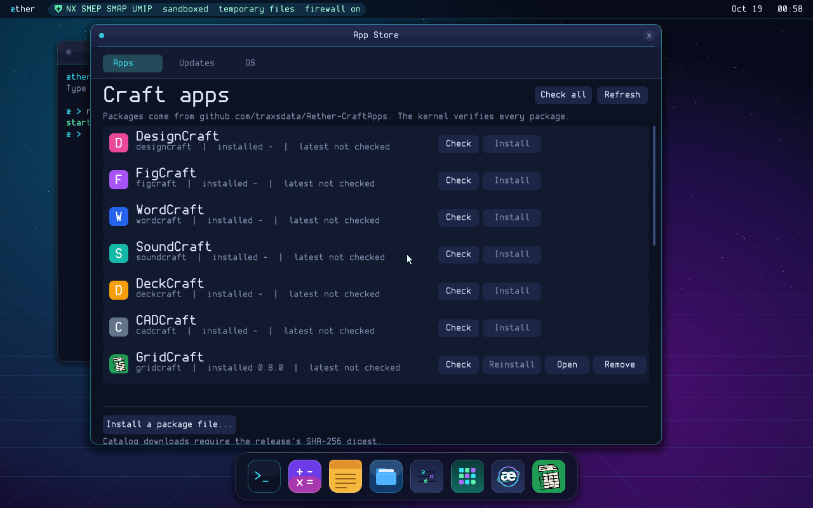

# Apps, the App Store and updates

æther 0.7 has three kinds of apps:

- **Built-in apps** are native C programs in the kernel image: Terminal,
  Calculator, Notes, Files and Probe. Their capabilities and trust come from
  `kernel/apps.c`.
- **System packages** ship on the ISO and use the package format: Settings
  and App Store are clean-room Rust apps drawn with `system-ui` and Facet, no
  egui or third-party crates. Their capabilities come from the `system_apps`
  manifest in `kernel/apps.c`, never from the header.
- **Installed apps** are packages the user added through App Store. They are
  always untrusted and get at most a window, the file picker, a private folder
  and outgoing connections (each connection still passes the firewall).

All three appear in the same program table and the dock.

## The package format

`tools/mkapp.py` wraps a static ELF in a 512-byte header:

| Field | Meaning |
|---|---|
| `magic` / `format` | `AETHAPP1`, format 1 |
| `name` | `a-z`, `0-9` and `-`, at most 15 characters |
| `title`, `version`, `source` | shown in the dock and App Store |
| `caps` | requested capabilities (system apps: advisory) |
| `abi` | `aether` or `linux` (Rust programs use the Linux layer) |
| `mem_quota_mib` | memory limit, clamped to 16..512 MiB |
| `elf_size`, `elf_sha256` | the image and its SHA-256 |
| `icon_format`, `icon_width`, `icon_height` | optional RGBA icon, at most 256x256 |
| `icon_offset`, `icon_size`, `icon_sha256` | where the icon starts (after the ELF), its size and its SHA-256 |

The kernel checks the header, the name, the SHA-256 and the ELF image before a
package is installed or started. It checks the optional icon too: bounds,
size and hash. The dock draws the icon. App Store asks the kernel for an
installed package's icon with `SYS_APP_ICON`; apps that aren't installed (or
have no icon) show a coloured initial instead. The icon never leaves the
package's own memory except through that bounded copy.

The browser, Settings, App Store and the Craft apps have icons in
`assets/icons/`. The Craft icons come from the `storytold/<app>` source trees,
are Apache-2.0, and are listed in `assets/icons/craft/NOTICE`. They are
compiled only into the apps' own untrusted packages, never into App Store or
another trusted system app. The build scripts pass them to
`tools/mkapp.py --icon`.



`elf_check()` applies the same rules as
`elf_load()`: user-space addresses only, no writable+executable segment, an
entry point inside an executable segment, and no interpreter. A package that
could never run is refused at install time.

## Where packages live

- ISO packages are loaded by the UEFI loader from `\apps` and registered at
  boot.
- Installed packages are kept in `/system/apps` on the encrypted volume. Apps
  can't open `/system`; only the kernel's app store code reads or writes it.
  Installed apps survive reboots when there is a real disk; on temporary
  storage they last until shutdown.

At boot, the kernel registers the ISO's system apps first (in the manifest's
order, so the dock is stable), then any user apps. `/system/apps` is scanned
after the volume is unlocked.

## Installing and updating

App Store (`installer`) has a window, outgoing network, the app API, spawning,
the picker and private storage (the latter two so it can hand them to an app
it starts). It downloads a package over https and requires the release's
`sha256:` digest; a missing or unknown digest is refused. It then passes the
bytes to `SYS_APP_INSTALL`, and the kernel repeats the header/hash/ELF checks
and writes the package to `/system/apps`. An OS image is saved through the
system picker, not by path.

- **Install** registers the package and it appears in the dock.
- **Update** replaces the stored package and the program table entry. It
  keeps the capabilities the user already approved; a package cannot add
  `CAP_NET` or `CAP_PICK` through an update. Widening an app's permissions
  means removing and installing it deliberately.
- **A running app is never restarted behind the user's back.** Its old code
  stays in its address space; the new version starts next time. The kernel
  marks the process `update_pending`, and its title bar shows an
  `update pending` note. App Store also shows the pending state.
- **Remove** is refused while the app is running.
- **Local package files** are installed without replacement first. If the
  name is already installed, the UI shows the old and new `source` strings
  and asks before replacing; a replacement inherits the old app's private
  folder. The UI says that the replacement cannot add a capability.

Apps that are part of the OS cannot be replaced or removed by App Store; OS
updates are handled by the OS tab instead.

## What is and is not verified

The kernel verifies integrity: the package header, name, SHA-256 and the whole
ELF image (and the optional icon). Since **1.4** a package may also carry a
publisher signature: a 256-byte RSA-2048 PKCS#1 v1.5 SHA-256 trailer after the
icon. It covers the header, ELF and icon, so changing any of them invalidates
the signature. The kernel's trust anchor is the same offline release key as
the OS image (`common/release_key.h`).

- **App Store downloads must be signed.** The installer passes
  `APP_INSTALL_SIGNED`; the kernel refuses a download with a missing, changed
  or non-release signature even if HTTPS and the release digest matched.
- **Local package files may be unsigned.** A file you choose yourself is
  accepted with the integrity checks only; the App Store shows its source
  before installation. An invalid signature is always refused.
- **Updates keep the old permissions.** A signed update cannot add `CAP_NET`
  or `CAP_PICK`; remove and reinstall deliberately to widen them.

A release account that has been compromised still cannot publish a package
signed by the offline key. Build packages with
`AETHER_APP_SIGNING_KEY=/secure/aether-release.pem make` (or pass `--key` to
`tools/mkapp.py`). The key must match `common/release_key.h`; the build
refuses one the kernel would not trust. OS system images are signed the same
way, and the loader pins the boot image's hash.

## Craft apps from GitHub

App Store lists the Craft apps whose sources are published at
`github.com/storytold`:

ArtCraft, VectorCraft, PhotoCraft, LightCraft, FilmCraft, PdfCraft,
EffectCraft, DesignCraft, FigCraft, WordCraft, SoundCraft, DeckCraft, CADCraft,
GridCraft and ArtCraft Launcher.

The æther builds of those apps live in a separate repository,
[`github.com/traxsdata/Aether-CraftApps`](https://github.com/traxsdata/Aether-CraftApps).
Its manual **Build Craft apps for æther** workflow checks out this repository
(at a branch, tag or commit you choose), clones each app's source, builds it
unmodified against `runner/eframe` with `tools/build-craft.sh`, and publishes
the packages to one release, `craft-apps-latest`:

| Asset | What it is |
|---|---|
| `<app>-<version>-aether-x86_64.aeapp` | the package, byte for byte; App Store installs this |
| `<app>-<version>-aether-x86_64.app.zip` | the same package as a `.app` file, for manual download |
| `craft-apps.json`, `<app>.json` | version, source commit, Aether commit, icon and SHA-256 of each package |

GitHub refuses release assets ending in `.app`, hence `.aeapp`. App Store
reads the `craft-apps-latest` release with a single GitHub API call, takes
each app's latest version from the asset name, and requires GitHub's SHA-256
digest for the asset before it hands the download to the kernel. A direct
`.aeapp` or `.app` is installed as it is; if a release only publishes the
`.app.zip`, App Store verifies the release digest over the ZIP, checks the
ZIP entry's CRC, extracts the single `.app`, and then the kernel checks the
package header, icon, SHA-256 and ELF image. The build tooling
(`tools/build-craft.sh`, `tools/craft-build.sh`, `tools/mkapp.py`) and the
per-app shells in `tools/craft-shells/` stay here, next to the runner they
build against; only apps with a shell can be built.

The packages carry the app's own icon from `assets/icons/craft/` (the
Build Craft apps workflow passes it to `tools/mkapp.py --icon`), so the dock
shows the Craft icon and App Store shows it once the app is installed.

The ordinary Linux release binaries in the Craft repositories are built
against a desktop Linux (glibc/wgpu); they are not æther packages and are
deliberately not installed.

**Current status (0.7):** GridCraft and PhotoCraft have shells, and their
packages (with icons) are published through Aether-CraftApps. Both are
under the kernel's 128 MiB package cap (PhotoCraft's package is about 70 MiB,
already stripped). Packages built from an Aether commit before 0.7 have no
icon and show a coloured letter in the dock until the release is rebuilt;
`make craft-apps` warns about them. Apps without an æther build show "No æther build published
yet". App Store also installs a package file you choose, including an
`.app.zip` it can unpack.

### Putting Craft apps on the ISO

```sh
make craft-apps                      # or CRAFT_APPS="gridcraft" make craft-apps
make
```

`tools/fetch-craft-apps.py` downloads the packages from the
`craft-apps-latest` release, checks each one against GitHub's SHA-256 digest
and the manifest's `package_sha256`, and saves it as `build/apps/<app>.app`,
which the ISO build puts in `/apps`.

### Building an æther Craft package by hand

```sh
tools/build-craft.sh gridcraft       # build/apps/gridcraft.app
```

or step by step:

```sh
git clone https://github.com/storytold/gridcraft
tools/craft-build.sh gridcraft gridcraft build/craft-out/gridcraft.elf
strip -o build/craft-out/gridcraft-stripped.elf build/craft-out/gridcraft.elf
tools/mkapp.py --name gridcraft --title GridCraft --version 0.8.0 \
    --source github.com/storytold/gridcraft@v0.8.0 --quota 1024 --net \
    --icon assets/icons/craft/gridcraft.png \
    build/craft-out/gridcraft-stripped.elf build/apps/gridcraft.app
```

The package header records the version, source and icon; App Store uses the
version in the release asset's name for "latest" and the installed package
for "installed". Attach the resulting `gridcraft-0.8.0-aether-x86_64.app` to
the release, or publish it as `.aeapp`/`.app.zip` as Aether-CraftApps does.

## OS updates

The OS tab checks `github.com/traxsdata/Aether` for the latest release with a
`aether-system-x86_64.img` asset. It downloads the image, requires the
release's SHA-256 `digest`, and passes it to `SYS_UPDATE_INSTALL`. The kernel
repeats the system image's header, range, canonical-hash and RSA-2048 release
signature checks before it writes anything. A kernel-drawn confirmation dialog
must be answered by the user first.

- The image is written to the **inactive** A/B system slot. The running slot
  and `/system` data are not changed.
- The boot-control record marks the new slot active and pending. The UEFI
  loader counts attempts and falls back to the last good slot if the new
  kernel does not reach its storage initialisation twice.
- Once the kernel and storage path are up, the kernel marks the slot good;
  the lock screen then appears as usual.
- A reboot is required. App updates remain live and need no reboot.

The UEFI loader in the ESP is stable and is not rewritten by an OS update.
The netboot ISO and loader change only through a deliberate netboot release.
See [INSTALL.md](INSTALL.md).

The image signature authenticates the publisher; the release digest and
HTTPS protect the download path. Secure Boot signing is still on the roadmap.

## Security notes

- Installed apps are always `TRUST_UNTRUSTED`, whatever their header says.
- The package name can't shadow a system program, and App Store can't install
  a package with a system app's name.
- The kernel keeps the package bytes in physical pages, not the 16 MiB kernel
  heap; a package is limited to 128 MiB (`APP_MAX_BYTES`).
- The `.app` hash is checked again on first start, so a damaged or modified
  package is refused. The optional icon is bounds- and hash-checked too; it
  is data, never executed.
- Downloads are https only. App Store still passes every connection through
  the firewall, which asks by app and host name the first time.
